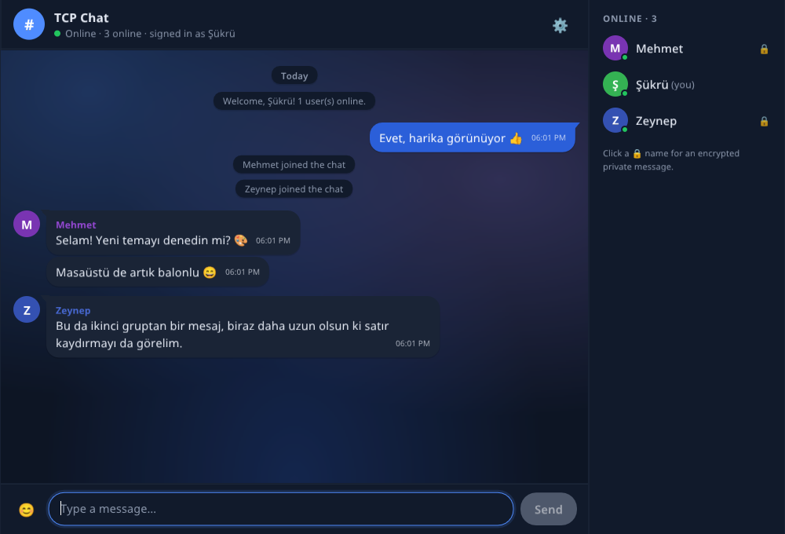

# Desktop app

A native chat client written in C++17 with [Dear ImGui](https://github.com/ocornut/imgui)
on GLFW + OpenGL 3. It looks like the [web client](../Web): same layout,
fonts, sizes, themes and backgrounds. It reuses the server's C protocol and
crypto modules directly from [`Backend/src`](../Backend/src), so it always
speaks exactly the same wire format.



## Requirements

- Linux (POSIX sockets)
- CMake 3.20+, a C11 and C++17 compiler
- GLFW 3, OpenGL, libsodium
- Internet access on the first configure. CMake fetches, at pinned versions:
  - Dear ImGui v1.92.9b
  - stb_image, for background pictures
  - the fonts: Noto Sans, Noto Sans Mono and Noto Color Emoji (SIL Open
    Font License, checked by SHA-256)

  Without the fonts the app falls back to system fonts.

```bash
# Fedora
sudo dnf install gcc-c++ cmake pkgconf-pkg-config glfw-devel mesa-libGL-devel libsodium-devel
# Debian / Ubuntu
sudo apt install build-essential cmake pkg-config libglfw3-dev libgl-dev libsodium-dev
```

Optional: `zenity` or `kdialog` for the "Upload image…" file dialog (without
them you can paste a path instead), and `notify-send` for notifications.

## Build and run

```bash
cmake -S . -B build
cmake --build build -j
./build/tcp-chat-desktop
```

Start a server first (`make run-server` in `Backend`), then enter the
server, the port (8080) and a name. The app remembers them for next time.

## Features

- **Messaging-app chat:**
  - Bubbles grouped by sender, avatars, day separators.
  - Recent history replayed on join (shown faded).
  - "Is typing…" indicators.
  - Smart auto-scroll: it does not jump while you read older messages.
- **Settings** (the ⚙️ button), the same as on the web:
  - Six themes, or "Match system", which follows GNOME's light/dark setting.
  - Accent and bubble colors.
  - Built-in backgrounds or your own picture, with dim and blur.
  - Text size and a compact mode.
  - Notifications for private messages and mentions.

  They are saved to `~/.config/tcp-chat/desktop.ini`.
- **Color emoji** with a picker. Noto Color Emoji is drawn by a small font
  loader (`src/emoji_font.cpp`), so no FreeType is needed.
- **End-to-end encrypted private messages:**
  - Click a 🔒 name in the user list.
  - The banner shows the safety number to compare with the other person.
- **Server identity:**
  - The first time you connect to a server, its key is remembered in
    `~/.config/tcp-chat/known_servers` (shared with the terminal client).
  - Settings → Connection shows its fingerprint.
  - If the key ever changes, the app refuses to connect and shows a warning.
- **Unread count** in the window title. Private messages and mentions also
  make the taskbar entry ask for attention.
- **Reconnects** automatically with backoff (1 s, 2 s, 4 s … 15 s).
- **`/users` and `/quit`** commands.
- **No networking thread:** the socket is polled once per frame. When idle,
  the app sleeps until input arrives, waking every 50 ms for the network.

## Command line

```
tcp-chat-desktop [--connect host port name] [--say text] [--settings] [--emoji] [--dm name]
                 [--theme id] [--wallpaper id|image] [--size WxH]
                 [--screenshot out.ppm --wait seconds]
```

| Option | |
|---|---|
| `--connect` | connect on start-up |
| `--say` | send one message once joined |
| `--settings` | open the settings panel |
| `--emoji` | open the emoji picker once joined |
| `--dm` | open a private chat with that user once possible |
| `--theme` | `system`, `midnight`, `daylight`, `ocean`, `forest`, `sunset` or `lavender` (this run only) |
| `--wallpaper` | `none`, `dots`, `grid`, `waves`, `bubbles`, `aurora`, `dusk` or an image file (this run only) |
| `--size` | window size, default `1000x680` |
| `--screenshot` | render in a hidden window, save a PPM after `--wait` seconds, exit |

Most of these exist for automated screenshots, for example:

```bash
./build/tcp-chat-desktop --connect 127.0.0.1 8080 demo --say "hello" \
    --theme sunset --wallpaper bubbles --screenshot shot.ppm --wait 2
magick shot.ppm shot.png
```

`TCPCHAT_DESKTOP_SETTINGS`, `TCPCHAT_KNOWN_SERVERS`, `TCPCHAT_KNOWN_PEERS`
and `TCPCHAT_USER_KEY` point the app at other files. Tests use them to stay
away from your real ones.

## Source

| File | |
|---|---|
| `chat_client.cpp` | nonblocking connection and chat state, no UI |
| `app.cpp` | the screens: login, chat, user list, DM banner, emoji picker |
| `chat_view.cpp` | message bubbles, grouping and day separators |
| `settings_ui.cpp` | the settings panel |
| `ui.cpp` | drawing helpers in CSS pixels: fonts, text, buttons, inputs |
| `theme.cpp` | the six palettes (mirroring `Web/src/theme/themes.js`) |
| `wallpaper.cpp` | backgrounds, blur and custom pictures |
| `emoji_font.cpp` | color emoji from a CBDT bitmap font |
| `settings.cpp` | `desktop.ini` load and save |
| `main.cpp` | GLFW window, command line, screenshot mode |

## Tests

`client_smoke` drives the networking layer without a window:

```bash
./build/client_smoke 127.0.0.1 8080
```

It uses temporary key files and checks:

- that an unknown server key is held until accepted
- joining, message echo and duplicate names
- quitting
- that a changed server key is refused
