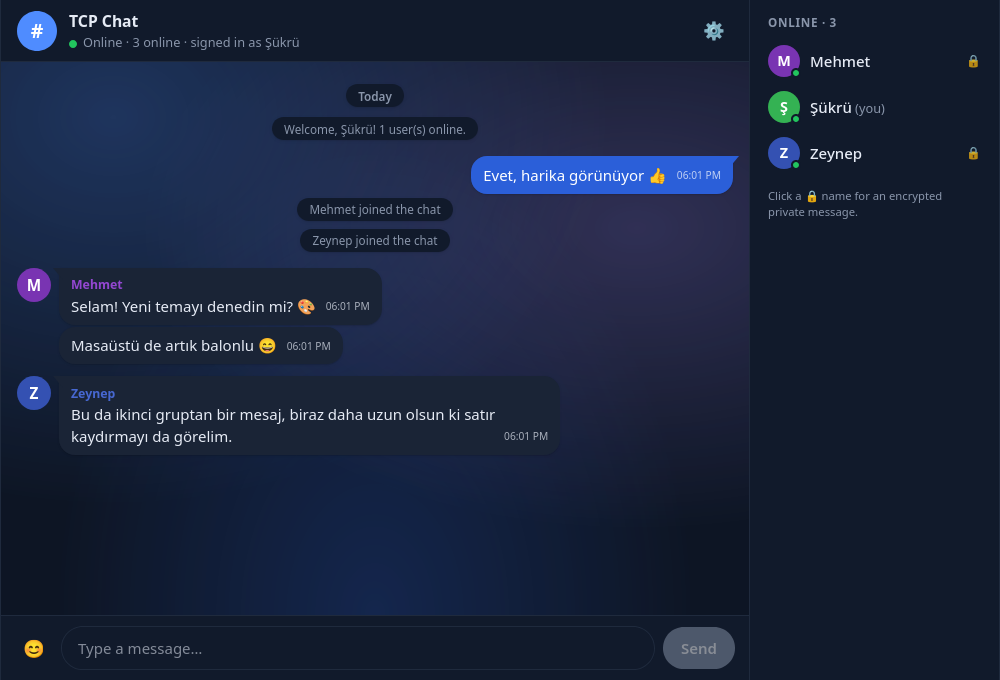
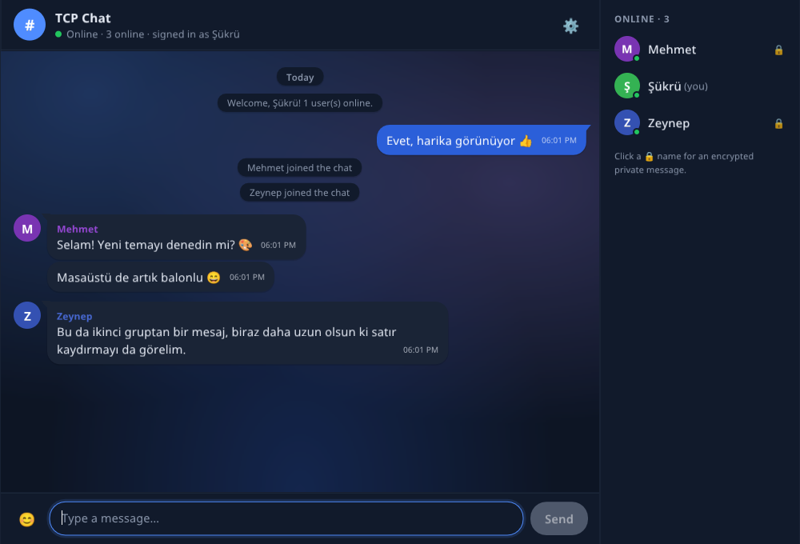

# TCP Chat

[](https://github.com/ohNando/tcp-chat/actions/workflows/ci.yml)
[](LICENSE)

An encrypted chat built from scratch to learn how networking really works:
a single-threaded `epoll` server in C, a binary protocol, a hand-written
WebSocket implementation, and three clients that all meet in the same room:
a terminal client, a React web client and a native Dear ImGui desktop app.

| Web client | Desktop app |
|---|---|
|  |  |

## Features

- **One thread, no locks.** The server is a single `epoll` event loop with
  nonblocking sockets, per-connection output buffers and `signalfd` for
  clean shutdown. A slow or dead client can never stall anyone else.
- **Own binary protocol.** Length-prefixed records and a 12-byte frame
  header, decoded strictly and covered by unit tests
  ([docs/PROTOCOL.md](docs/PROTOCOL.md)).
- **Encrypted connections.** X25519 key exchange per connection (forward
  secrecy), an Ed25519-signed handshake, and XChaCha20-Poly1305 records via
  libsodium. Tampered, replayed or reordered records are rejected.
- **Server identity pinning.** Clients remember the server's key on first
  use and refuse to connect if it changes.
- **WebSocket from scratch.** RFC 6455 upgrade, framing, fragmentation,
  ping/pong and close, plus static file serving with `sendfile()`.
- **Three clients, one room.** Terminal, browser and desktop users see each
  other, with join/leave notices, a live user list, recent history for
  newcomers and "is typing…" indicators.
- **Measured, not guessed.** A load generator reports latency percentiles
  and the server's CPU split; see [docs/PERFORMANCE.md](docs/PERFORMANCE.md)
  for how a 34 ms Nagle stall became 0.5 ms.
- **Resilient.** A heartbeat drops dead peers, and the web and desktop
  clients reconnect on their own.

## Architecture

```
 terminal client ─┐  TCP :8080
 desktop app ─────┤
                  ▼
        ┌──────────────────────────────┐
        │ server: one thread, epoll     │
        │ conn → secure channel → frame │
        │ room: names, broadcast        │
        └──────────────▲───────────────┘
                       │ HTTP + WebSocket :8081
                 browser (web client)
```

More in [docs/ARCHITECTURE.md](docs/ARCHITECTURE.md).

## Quick start

Requirements: Linux, GCC, Make, libsodium, Node.js 22 (web client), CMake
and GLFW (desktop app). Per-component details are in each README.

```bash
# 1. Server and terminal client
cd Backend
make
make run-server            # prints the server fingerprint

# 2. Terminal client (another terminal)
cd Backend && make run-client

# 3. Web client
cd Web && npm install && npm run build
# restart `make run-server`, then open http://localhost:8081

# 4. Desktop app
cd App && cmake -S . -B build && cmake --build build -j
./build/tcp-chat-desktop
```

## Project layout

| Folder | |
|---|---|
| [`Backend/`](Backend) | C server, terminal client, shared protocol and crypto modules, unit tests |
| [`Web/`](Web) | React + Vite client, JavaScript protocol implementation, end-to-end test |
| [`App/`](App) | C++ Dear ImGui desktop client |
| [`docs/`](docs) | protocol and architecture documentation |

## Security

What the encryption protects, and what it does not:

- Traffic between each client and the server is encrypted and
  authenticated; someone on the network can neither read nor modify it.
- Clients verify the server's identity key (pinned on first use), so a man
  in the middle is detected after the first connection.
- **It is not end-to-end encryption.** The server decrypts every message
  and re-encrypts it for each recipient, so whoever runs the server can
  read the chat.
- The web client is served over plain HTTP. That is fine on `localhost`;
  over a network, put it behind HTTPS.
- There are no user accounts or passwords: names are first come, first
  served.

See [SECURITY.md](SECURITY.md) for the threat model and how to report a
vulnerability.

## Background

This started as a pre-AI learning project: a thread-per-client chat server
in C to understand sockets and TCP. It has since been rebuilt around an
event loop, a proper framed protocol, encryption and multiple clients,
keeping the goal of learning how each layer works rather than hiding it
behind libraries.

## Contributing

See [CONTRIBUTING.md](CONTRIBUTING.md).

## License

[MIT](LICENSE)
