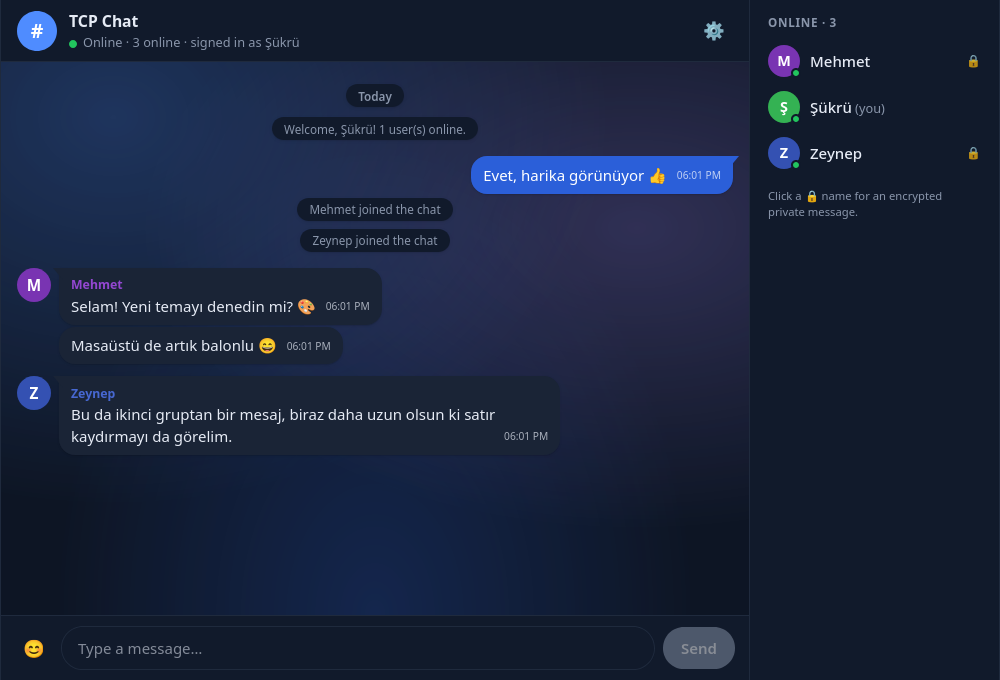

# Web client

A React (Vite) chat client that runs in the browser and talks to the C
server over WebSocket. It uses the same encrypted protocol as the terminal
and desktop clients (libsodium compiled to WebAssembly): traffic between the
browser and the server is encrypted and the server's identity is verified.



## Features

- **Messaging-app chat:**
  - Bubbles grouped by sender, avatars, day separators.
  - An emoji picker.
  - "Is typing…" indicators.
  - Recent history replayed on join.
- **Settings** (the ⚙️ button):
  - Six themes, or "Match system".
  - Accent and bubble colors.
  - Built-in backgrounds or an uploaded picture, with dim and blur.
  - Text size and a compact mode.
  - Optional browser notifications for private messages and mentions.

  Everything is kept in `localStorage`; uploaded pictures are shrunk to
  1920 px first.
- **Unread count** in the tab title while the tab is in the background.
- **End-to-end encrypted private messages:** click a 🔒 name.
- **Reconnects** with backoff when the connection drops.

## Requirements

- Node.js 22 or newer
- A running server from [`Backend`](../Backend)

## Install

```bash
npm install
```

## Use it

**Served by the C server** (recommended):

```bash
npm run build                    # writes dist/
cd ../Backend && make run-server # serves dist/ on port 8081
```

Open <http://localhost:8081>.

**Development with hot reload:**

```bash
cd ../Backend && make run-server # in one terminal
npm run dev                      # in another
```

Open <http://localhost:5173>. Vite proxies `/ws` to the server on port 8081.

## Scripts

| Script | |
|---|---|
| `npm run dev` | Vite dev server |
| `npm run build` | production build in `dist/` |
| `npm run lint` | ESLint |
| `npm test` | unit tests (`node --test`): codec, pinning, themes, grouping, unread |
| `npm run e2e` | starts `../Backend/bin/server` and chats over TCP and WebSocket |
| `npm run ui` | serves `dist/` from the C server and drives it in headless Firefox (chat, themes, backgrounds, emoji, settings that survive a reload) |

`npm run e2e` and `npm run ui` need the server binary: run `make` in
`Backend` first. `npm run ui` also needs Firefox and a fresh `npm run build`.

`npm run build` also writes brotli (`.br`) and gzip (`.gz`) copies of the
larger files; the server sends those to browsers that accept them, and lets
browsers cache the hashed files under `/assets/` for a year.

## How it works

| File | |
|---|---|
| `src/protocol/frame.js` | binary frame and message codec, mirror of `Backend/src/message.c` |
| `src/protocol/secure.js` | handshake and encrypted record layer, mirror of `Backend/src/secure.c` |
| `src/protocol/pins.js` | remembers the server fingerprint and users' DM keys in `localStorage` |
| `src/protocol/dm.js` | end-to-end encrypted private messages and safety numbers |
| `src/hooks/useChat.js` | WebSocket connection, reconnect with backoff, chat state |
| `src/App.jsx` | login, chat, online users and the "identity changed" warning |
| `src/chat/` | message grouping, avatar colors, unread count and notifications |
| `src/theme/` | themes, backgrounds and the saved settings (`useSettings`) |
| `src/components/` | settings panel, emoji picker, avatar |

The server is the single source of truth: your own messages appear when the
server broadcasts them back, so every client shows the same order.

On the first connection the server's fingerprint is saved for that host,
quietly. You can see it under Settings → Connection and compare it with the
one the server prints when it starts. If it ever changes, the app refuses to
connect and shows the old and new fingerprints side by side.

> The page itself is served over plain HTTP. That is fine on `localhost`,
> but over a network someone in the middle could modify the JavaScript
> before it reaches the browser. Serve it over HTTPS (for example behind a
> reverse proxy) for anything beyond local use.
